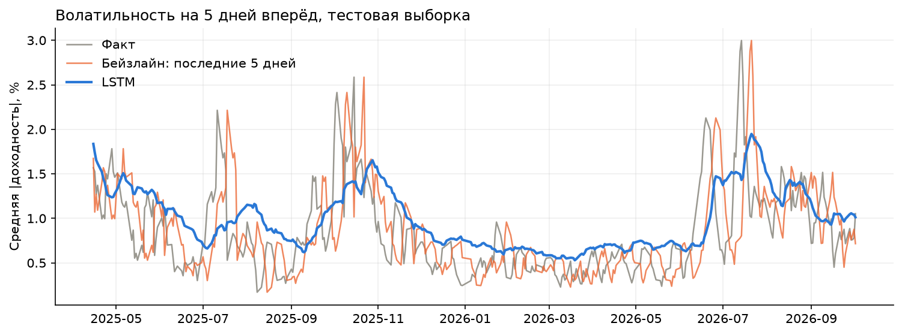
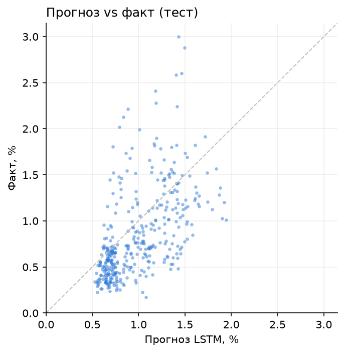
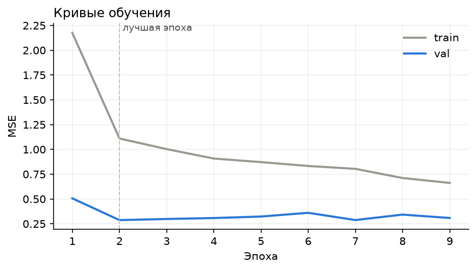

# Прогноз волатильности акций MOEX с помощью LSTM

Модель предсказывает **среднюю волатильность акции Сбербанка на 5 торговых дней вперёд** по дневным данным Московской биржи: свечам акции, индексу IMOEX и курсу CNY/RUB. Входом служит окно за последние 30 дней.



## Результаты

Тестовая выборка — последние 15% истории (прогнозы с апреля 2025 по октябрь 2026, всего 374). Все модели оцениваются на одних и тех же днях.

| Модель | MSE | MAE | Корреляция | Улучшение MSE над константой |
|---|---|---|---|---|
| Константа (среднее train) | 0.583 | 0.683 | — | 0% |
| Наивный прогноз: «как последние 5 дней» | 0.258 | 0.367 | 0.46 | 56% |
| Ridge по развёрнутому окну 30×8 | 0.341 | 0.514 | 0.54 | 42% |
| **LSTM** | **0.186** | **0.338** | **0.56** | **68%** |

Таргет измеряется в процентах. Например, MAE 0.34 значит, что прогноз в среднем ошибается на 0.34 п.п., а типичная волатильность за 5 дней — около 0.5–1.5%.

Числа приведены для `seed=0`.

<p>
  
  
</p>


**Признаки**:

| Признак | Описание |
|---|---|
| `RET` | лог-доходность акции |
| `RANGE` | внутридневной размах `(HIGH − LOW) / LOW` |
| `VOL_CHG` | изменение лог-объёма торгов |
| `VOLAT` | стандартное отклонение доходности за 20 дней |
| `MA_RATIO` | отклонение цены от скользящей средней за 20 дней |
| `IMOEX_RET` | доходность индекса Мосбиржи |
| `CNY_RET` | доходность курса юаня |
| `REL_RET` | доходность акции минус доходность индекса |

**Модель:** 2-слойная LSTM и линейный слой по последнему скрытому состоянию. Обучение с Adam, MSE и early stopping по валидации.

**Защита от утечек:**
- разбиение строго по времени: 70% train, 15% val, 15% test;
- `StandardScaler` обучается только на train;
- последние 5 строк train и val выкидываются, потому что их таргет смотрит в следующую выборку;
- эпоха выбирается по val, а тест используется только для финальной оценки.

## Структура

```
├── src/
│   ├── data.py       загрузка с MOEX ISS, кэш в data/
│   ├── features.py   признаки, таргет, разбиение, масштабирование
│   ├── dataset.py    WindowDataset, окна для линейных моделей
│   ├── model.py      LSTM
│   └── train.py      обучение, бейзлайны, метрики, графики
└── results/          графики и metrics.json
```

## Запуск

```bash
pip install -r requirements.txt
python -m src.train                 # SBER, графики и метрики → results/
python -m src.train --ticker GAZP   # другая акция
python -m src.train --help          # все параметры
```

При первом запуске данные скачиваются с MOEX ISS в `data/`. Флаг `--refresh` скачивает их заново.


